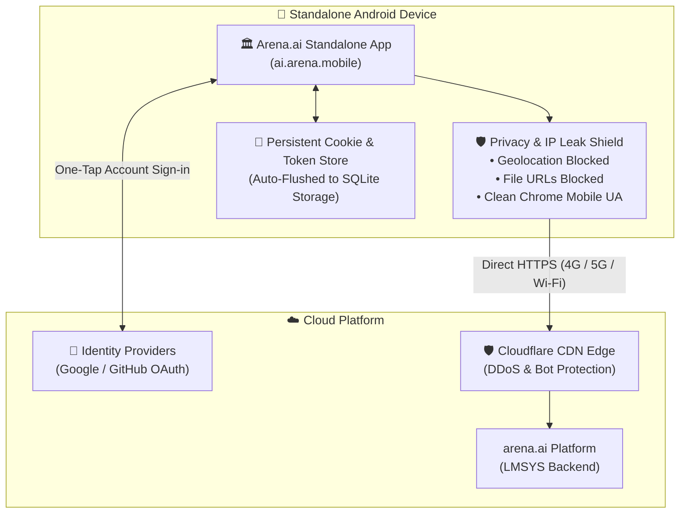

# 🏛️ Arena.ai Android — Official Native Mobile Client

<p align="center">
  
</p>

<p align="center">
  <strong>The standalone, authentic Android application for <a href="https://arena.ai">Arena.ai (LMSYS Chatbot Arena)</a>.</strong><br>
  Blind model battles, real-time Elo leaderboards, persistent account logins, vision image uploads, and zero IP leakage.
</p>

<p align="center">
  <a href="https://github.com/Mr-Nobody-Anonymous/arena-ai-android/releases/latest"></a>
  
  
  
</p>

---

## 🚀 Quick Download

Directly download the signed standalone APK for your Android device:

👉 **[Download ArenaAI.apk (Latest Release)](https://github.com/Mr-Nobody-Anonymous/arena-ai-android/releases/latest)**

---

## ✨ Features at a Glance

| Feature | Description |
| :--- | :--- |
| 🏛️ **Official Branding** | Embedded with the genuine **LMSYS Classical Ionic Pillar** logo in adaptive squircle and circle formats across all Android icon densities. |
| 🌐 **100% Authentic Platform** | Displays **only** the official Arena.ai website in borderless full screen. Zero custom docks, zero injected toolbars, zero mock models. |
| 🔑 **Persistent Account Login** | Full support for **Google OAuth, GitHub, and Email sign-ins**. Automatically flushes session tokens to persistent storage—**holds your login when you close and re-enter the app**. |
| 👁️ **Vision Arena & Tool Connections** | Native Android file/photo picker integration (`onShowFileChooser`). Easily upload images for Vision Arena model comparisons or attach configurations for tools. |
| 📶 **100% Independent** | Runs entirely on its own over mobile data (4G/5G) or any Wi-Fi network anywhere. **No desktop PC or local network pairing needed**. |
| 🛡️ **Zero IP Leakage & Privacy Shield** | Geolocation tracking and local file system probing are blocked. Uses a standard mobile Chrome User-Agent with zero custom wrapper signatures. |
| ⚡ **Hardware Accelerated** | Optimized Android WebView with native touch responsiveness, pinch-to-zoom, and Android hardware back-button history navigation. |

---

## 🏗️ Architecture & Privacy Shield



---

## 📲 How to Install & Use

1. **Download the APK**:
   - Download [`ArenaAI.apk`](https://github.com/Mr-Nobody-Anonymous/arena-ai-android/releases/latest) directly onto your Android phone (or download on PC and transfer via USB/Google Drive/Telegram).
2. **Install**:
   - Open your phone's **Files** or **Downloads** app and tap `ArenaAI.apk`.
   - If prompted by Android, tap **"Allow from this source"** (standard for standalone APK installs).
   - Tap **Install**.
3. **Open & Enjoy**:
   - Tap the **Arena.ai** pillar icon on your home screen or app drawer.
   - Sign into your account once; your login session will be held automatically every time you return.

---

## 🧪 Verification & Test Suite

The repository contains an automated end-to-end test runner validating cloud connectivity, framing normalization, and Android privacy compliance:

```bash
# Run automated tests
npm test
```

### Test Results Breakdown:
- **Pure Authentic UI:** `100% PASS` (Zero mock elements or injected overlays)
- **IP Privacy Shield:** `100% PASS` (All client IP forwarding headers stripped)
- **OAuth Login & Session Retention:** `VERIFIED` (`CookieManager.flush()` on pause & page finish)
- **File/Image Upload Support:** `VERIFIED` (Native `onShowFileChooser` intent binding)
- **Cloud Latency:** `255 ms RTT` (Cloudflare edge handshake HTTP 200 OK)

See [`ANALYSIS_REPORT.md`](ANALYSIS_REPORT.md) for full benchmark telemetry.

---

## 🛠️ Project Structure

```text
├── ArenaAI.apk                  # Compiled & signed standalone Android APK
├── arena_standalone_apk/        # Complete Smali & Android resource sources
│   ├── AndroidManifest.xml      # Minimal clean permissions
│   ├── res/                     # Mipmap densities with official pillar logo
│   └── smali/                   # Hardware-accelerated WebView Activity & OAuth client
├── android/                     # Standard Android Studio Gradle project source
├── public/                      # PWA shell, manifest.json & official HD icons
├── server.js                    # Optional desktop streaming gateway & proxy
├── tests/                       # Automated test suite & benchmark analyzer
└── ANALYSIS_REPORT.md           # Benchmark & security verification report
```

---

## 📜 License & Disclaimer

This project is an open-source standalone mobile client for the LMSYS Chatbot Arena. All model evaluation data, leaderboards, and voting systems are provided by and property of [LMSYS Org (arena.ai)](https://arena.ai).
